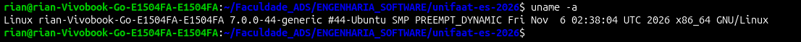
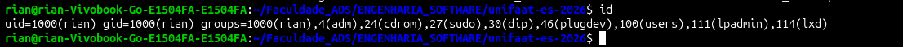
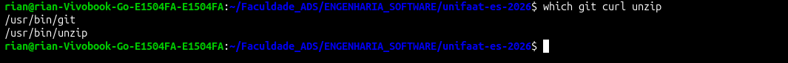
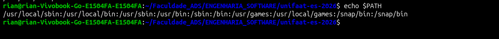
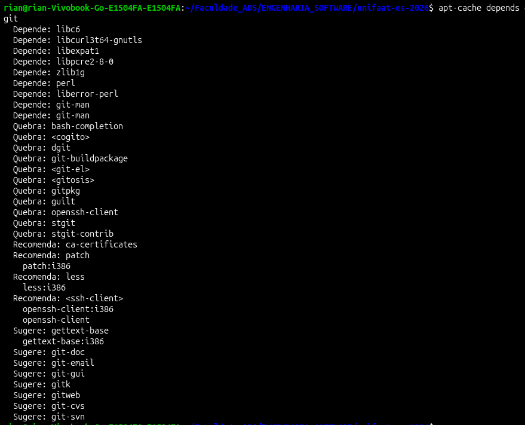
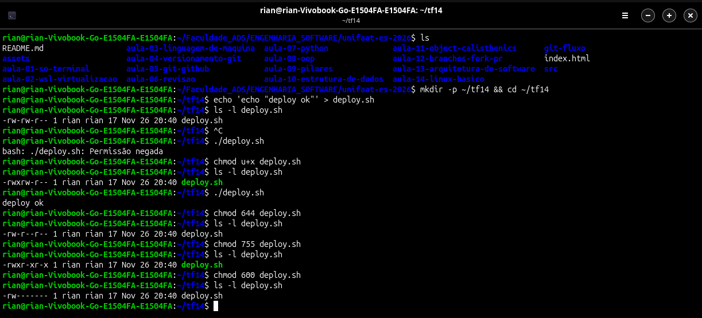
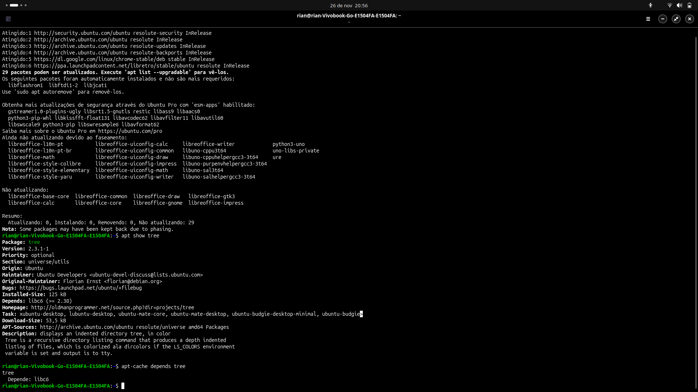

# TF 14 · Linux Básico

Nome: Rian do Prado Oliveira
RA: 6326066
GitHub: https://github.com/rianprado747-lab

> Rode tudo no **terminal do WSL (Ubuntu)**, no seu computador. Em cada item, cole o **comando** e a
> **saída** num bloco de código, **tire o print** (com o seu usuário e o prompt visíveis) e salve com o nome
> indicado **neste diretório**, e escreva a explicação em texto corrido, com as suas palavras. Apague
> as linhas entre parênteses ao responder. Não cole conteúdo de chaves SSH nem senhas.

---

## Parte 1 · Diário de terminal

Rode cada comando, cole a saída e explique o que ela mostra.

### 1.1 · `uname -a`

```text
Linux rian-Vivobook-Go-E1504FA-E1504FA 7.0.0-44-generic #44-Ubuntu SMP PREEMPT_DYNAMIC Fri Nov  6 02:38:04 UTC 2026 x86_64 GNU/Linux
```



**Explicação:** Estou usando o kernel GNU/Linux, o nome dá maquina é rian-Vivobook-Go-E1504FA-E1504FA

### 1.2 · `id`

```text
uid=1000(rian) gid=1000(rian) groups=1000(rian),4(adm),24(cdrom),27(sudo),30(dip),46(plugdev),100(users),111(lpadmin),114(lxd)

```



**Explicação:** Usuário rian, grupos : rian, adm, cdrom, sudo, dip, plugdev, users, lpadmin e lxd.
Sudo permite rodar comandos administrativos como root usando sudo (instalar pacotes, alterar configurações do sistema, gerenciar serviços e permissões), exigindo sua senha.

### 1.3 · `which git curl unzip`

```text
/usr/bin/git
/usr/bin/unzip
```



**Explicação:** cada binário esta na pasta usr/bin/, quando algum não aparece significa que não está instalado ou o execuável não está em nenhum diretório
listado na variavél PATH, para instalar pacotes usamos `sudo apt update` para atualizar os pacotes e instalamos o pacote correspodente com `sudo apt instal pacote'
### 1.4 · `echo $PATH`

```text
/usr/local/sbin:/usr/local/bin:/usr/sbin:/usr/bin:/sbin:/bin:/usr/games:/usr/local/games:/snap/bin:/snap/bin
```



**Explicação:** temos 9 diretórios, o primeiro é usr/local/bin. 
A ordem importa posi quando você digita um comando no terminal, o shell percorre o PATH da esquerda para a direita e executa o primeiro executável com esse nome que encontrar

### 1.5 · `ls -la ~`

```text
total 116
drwxrwxr-x 20 rian rian  4096 Nov 25 21:24 .
drwxrwxr-x  8 rian rian  4096 Nov  4 21:07 ..
drwxrwxr-x  7 rian rian  4096 Nov 26 20:27 .git
-rw-rw-r--  1 rian rian   219 Oct  8 20:48 .gitignore
-rw-rw-r--  1 rian rian  3865 Oct 28 19:30 README.md
drwxrwxr-x  2 rian rian  4096 Nov 25 21:08 assets
drwxrwxr-x  4 rian rian  4096 Oct  8 20:48 aula-01-so-terminal
drwxrwxr-x  4 rian rian  4096 Oct  8 20:48 aula-02-wsl-virtualizacao
drwxrwxr-x  4 rian rian  4096 Oct  8 20:48 aula-03-linguagem-de-maquina
drwxrwxr-x  4 rian rian  4096 Oct  8 20:48 aula-04-versionamento-git
drwxrwxr-x  4 rian rian  4096 Oct 28 19:30 aula-05-git-github
drwxrwxr-x  6 rian rian  4096 Oct 28 19:30 aula-06-revisao
drwxrwxr-x  5 rian rian  4096 Oct  8 20:48 aula-07-python
drwxrwxr-x  5 rian rian  4096 Oct 28 19:30 aula-08-oop
drwxrwxr-x  6 rian rian  4096 Nov  4 19:30 aula-09-pilares
drwxrwxr-x  5 rian rian  4096 Oct 28 19:30 aula-10-estrutura-de-dados
drwxrwxr-x  5 rian rian  4096 Nov  4 19:30 aula-11-object-calisthenics
drwxrwxr-x  5 rian rian  4096 Nov 11 21:41 aula-12-branches-fork-pr
drwxrwxr-x  4 rian rian  4096 Nov 25 21:08 aula-13-arquitetura-de-software
drwxrwxr-x  4 rian rian  4096 Nov 25 21:45 aula-14-linux-basico
drwxrwxr-x  2 rian rian  4096 Nov 11 21:41 git-fluxo
-rw-rw-r--  1 rian rian 24656 Nov 25 21:08 index.html
drwxrwxr-x  7 rian rian  4096 Nov  4 19:30 src

```


**Explicação:** Na listagem apresentada, o diretório oculto .git guarda todo o histórico de commits, branches e configurações do controle de versão local, enquanto o arquivo .gitignore define quais arquivos e pastas o Git deve ignorar e não rastrear. Já no diretório aula-14-linux-basico, a sequência drwxrwxr-x indica inicialmente pela letra d que o item é um diretório; em seguida, o primeiro bloco rwx dá ao dono (rian) permissão de leitura, escrita e execução (entrar na pasta), o segundo bloco rwx concede essas mesmas três permissões ao grupo (rian), e o bloco final r-x permite que outros usuários apenas leiam e entrem no diretório, sem permissão de escrita (-).

### 1.6 · `apt-cache depends git`

```text
git
  Depende: libc6
  Depende: libcurl3t64-gnutls
  Depende: libexpat1
  Depende: libpcre2-8-0
  Depende: zlib1g
  Depende: perl
  Depende: liberror-perl
  Depende: git-man
  Depende: git-man
  Quebra: bash-completion
  Quebra: <cogito>
  Quebra: dgit
  Quebra: git-buildpackage
  Quebra: <git-el>
  Quebra: <gitosis>
  Quebra: gitpkg
  Quebra: guilt
  Quebra: openssh-client
  Quebra: stgit
  Quebra: stgit-contrib
  Recomenda: ca-certificates
  Recomenda: patch
    patch:i386
  Recomenda: less
    less:i386
  Recomenda: <ssh-client>
    openssh-client:i386
    openssh-client
  Sugere: gettext-base
    gettext-base:i386
  Sugere: git-doc
  Sugere: git-email
  Sugere: git-gui
  Sugere: gitk
  Sugere: gitweb
  Sugere: git-cvs
  Sugere: git-svn
```



**Explicação:** Entre as dependências diretas do Git, a libc6 é a biblioteca padrão C do sistema GNU que fornece as funções básicas essenciais para a execução dos programas no Linux, a libcurl3t64-gnutls permite a transferência de dados pela rede via protocolos como HTTP e HTTPS para operações como clone, fetch e push, e a zlib1g realiza a compressão e descompressão de dados para economizar espaço em disco e banda nos repositórios. O gerenciador de pacotes (apt) traz todas essas dependências de uma só vez porque resolve automaticamente toda a árvore de requisitos e compatibilidade de versões antes da instalação, garantindo que o software funcione imediatamente sem falhas por bibliotecas ausentes e evitando um sistema com pacotes quebrados.

---

## Parte 2 · Permissões na prática

Rode os comandos na ordem e cole a saída de cada `ls -l` e de cada execução.

```bash
mkdir -p ~/tf14 && cd ~/tf14
echo 'echo "deploy ok"' > deploy.sh
ls -l deploy.sh
./deploy.sh
chmod u+x deploy.sh
ls -l deploy.sh
./deploy.sh
chmod 644 deploy.sh
ls -l deploy.sh
chmod 755 deploy.sh
ls -l deploy.sh
chmod 600 deploy.sh
ls -l deploy.sh
```

**Saídas:**

```text
-rw-rw-r-- 1 rian rian 17 Nov 26 20:40 deploy.sh
-rwxrw-r-- 1 rian rian 17 Nov 26 20:40 deploy.sh
-rw-r--r-- 1 rian rian 17 Nov 26 20:40 deploy.sh
-rwxr-xr-x 1 rian rian 17 Nov 26 20:40 deploy.sh
-rw------- 1 rian rian 17 Nov 26 20:40 deploy.sh

```



**Explicação:** O primeiro ./deploy.sh resultou em Permissão negada porque arquivos comuns recém-criados nascem sem o bit de execução (-rw-rw-r--), e rodar o arquivo diretamente com ./ exige que o sistema operacional tenha autorização para executá-lo como programa. Ao rodar chmod u+x deploy.sh, foi adicionada a letra x (execute) especificamente ao bloco de permissões do dono (u), alterando a linha do ls -l de -rw-rw-r-- para -rwxrw-r-- e liberando a execução para o seu usuário.

Na notação octal, a permissão 644 (-rw-r--r--) concede leitura e escrita ao dono (rw-) e apenas leitura ao grupo (r--) e a outros (r--), sendo o padrão ideal para arquivos comuns, textos e configurações sem segredos. Já 755 (-rwxr-xr-x) dá controle total ao dono (rwx) e leitura e execução ao grupo (r-x) e a outros (r-x), sendo usada em scripts executáveis, binários e diretórios que precisam ser acessados ou rodados por terceiros sem que possam alterá-los. Por fim, 600 (-rw-------) restringe leitura e escrita exclusivamente ao dono (rw-), bloqueando totalmente grupo (---) e outros (---), o que é indicado para arquivos privados, senhas e credenciais.

A chave SSH privada exige a permissão 600 por uma trava de segurança do próprio cliente SSH (como o OpenSSH), que recusa a chave caso ela esteja legível por grupo ou outros usuários da máquina. Como a chave privada comprova sua identidade criptográfica perante servidores remotos, mantê-la restrita exclusivamente ao dono evita que outros usuários ou processos comprometidos do sistema leiam o arquivo e se passem por você.

---

## Parte 3 · Gerenciador de pacotes (apt)

Rode os comandos na ordem e cole a saída de cada um (se a saída for muito longa, cole só as
**10 primeiras linhas** e escreva `(...)`).

```bash
sudo apt update && sudo apt upgrade -y
apt show tree
apt-cache depends tree
sudo apt install tree -y
which tree
tree --version
sudo apt remove tree -y
which tree
```

**Saídas:**

```text
~$ sudo apt update && sudo apt upgrade -y
[sudo: authenticate] Senha:        
Obter:1 http://security.ubuntu.com/ubuntu resolute-security InRelease [137 kB]                                             
Atingido:2 http://archive.ubuntu.com/ubuntu resolute InRelease                                                             
Obter:3 https://dl.google.com/linux/chrome-stable/deb stable InRelease [2.548 B]                                           
Obter:4 http://archive.ubuntu.com/ubuntu resolute-updates InRelease [137 kB]                                               
Obter:5 https://dl.google.com/linux/chrome-stable/deb stable/main amd64 Packages [1.406 B] (...)

~$ apt show tree
Package: tree
Version: 2.3.1-1
Priority: optional
Section: universe/utils
Origin: Ubuntu
Maintainer: Ubuntu Developers <ubuntu-devel-discuss@lists.ubuntu.com>
Original-Maintainer: Florian Ernst <florian@debian.org>
Bugs: https://bugs.launchpad.net/ubuntu/+filebug
Installed-Size: 125 kB
Depends: libc6 (>= 2.38)
Homepage: http://oldmanprogrammer.net/source.php?dir=projects/tree
Task: xubuntu-desktop, lubuntu-desktop, ubuntu-mate-core, ubuntu-mate-desktop, ubuntu-budgie-desktop-minimal, ubuntu-budgie>
Download-Size: 53,5 kB
APT-Manual-Installed: yes
APT-Sources: http://archive.ubuntu.com/ubuntu resolute/universe amd64 Packages
Description: displays an indented directory tree, in color
 Tree is a recursive directory listing command that produces a depth indented
 listing of files, which is colorized ala dircolors if the LS_COLORS environment
 variable is set and output is to tty.

apt-cache depends tree
tree
  Depende: libc6

apt-cache depends tree
tree
  Depende: libc6
rian@rian-Vivobook-Go-E1504FA-E1504FA:~$ sudo apt install tree -y
tree já é a versão mais nova (2.3.1-1).     
Os seguintes pacotes foram automaticamente instalados e não são mais requeridos:
  libflashrom1  libftdi1-2  libjcat1
Use 'sudo apt autoremove' para removê-los.

Resumo:
  Atualizando: 0, Instalando: 0, Removendo: 0, Não atualizando: 29

tree --version
tree v2.3.1 © 1996 - 2026 by Steve Baker, Thomas Moore, Francesc Rocher, Florian Sesser, Kyosuke Tokoro

sudo apt remove tree -y
Os seguintes pacotes foram automaticamente instalados e não são mais requeridos:
  libflashrom1  libftdi1-2  libjcat1
Use 'sudo apt autoremove' para removê-los.

REMOVENDO:
  tree

Resumo:
  Atualizando: 0, Instalando: 0, Removendo: 1, Não atualizando: 29
  Espaço liberado: 125 kB

(Lendo banco de dados ... 259415 arquivos e diretórios atualmente instalados).
Removendo tree (2.3.1-1) ...
Processando gatilhos para man-db (2.13.1-1build1) ...

```



**Explicação:** O apt update atualiza apenas as listas locais de pacotes e versões disponíveis nos repositórios, enquanto o apt upgrade instala versões mais novas dos pacotes já presentes no sistema com base nessas listas, sendo importante executá-los nessa ordem para não usar índices desatualizados, perder correções ou falhar ao buscar versões antigas já removidas. Segundo a saída do apt-cache depends tree, o pacote depende apenas da biblioteca libc6 (com versão mínima >= 2.38 exibida no apt show tree), e o binário de pacotes instalados via apt fica no diretório /usr/bin (em /usr/bin/tree). Por fim, antes da remoção, which tree apontava para /usr/bin/tree, mas após o remove o executável é apagado e o segundo which tree deixa de encontrá-lo no PATH, retornando saída vazia e código de saída diferente de zero.
