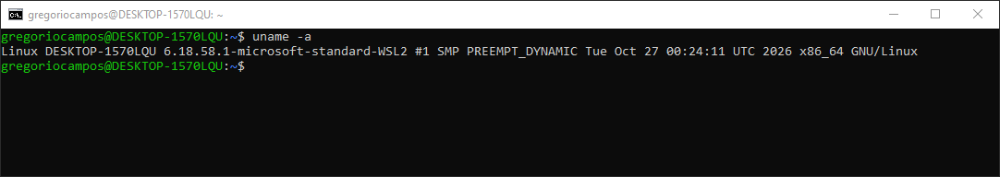
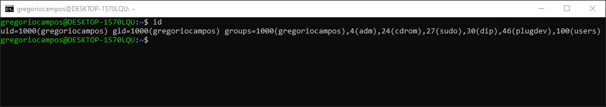
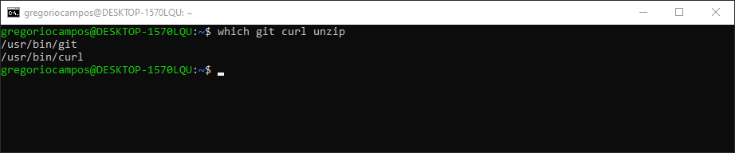
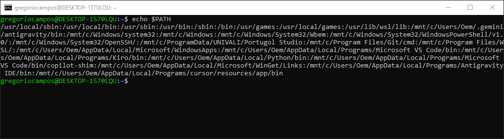
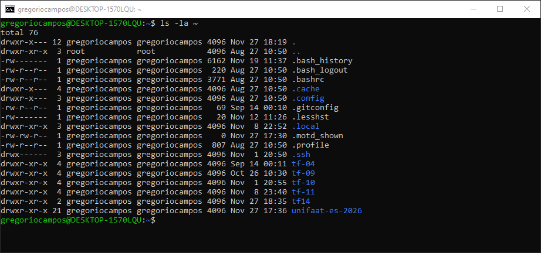
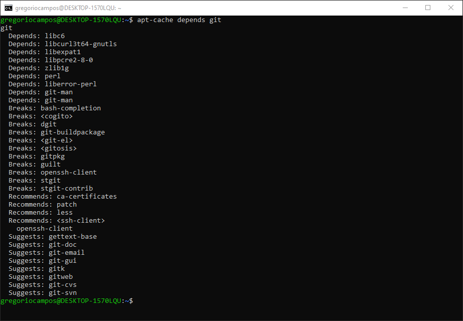
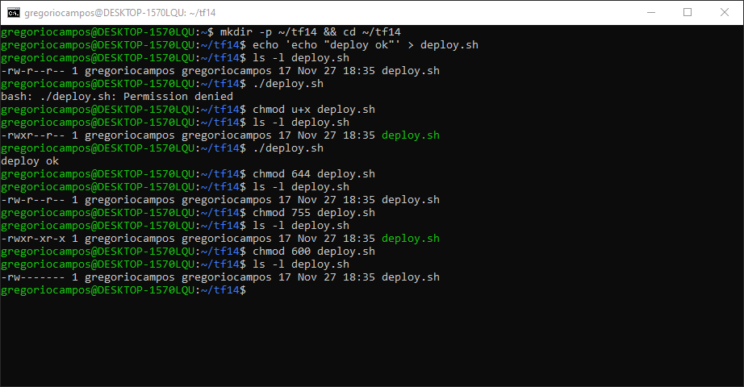
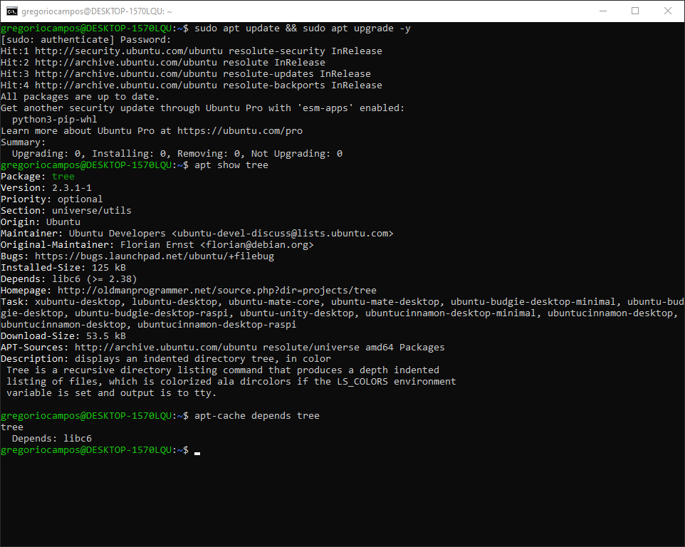
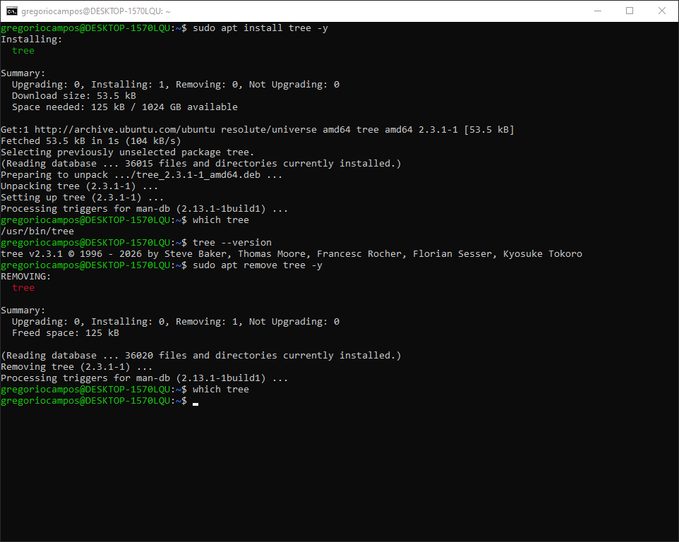

# TF 14 · Linux Básico

Nome: Gregório Gabriel de Campos
RA: 6326108
GitHub: https://github.com/Camposz1

> Rode tudo no **terminal do WSL (Ubuntu)**, no seu computador. Em cada item, cole o **comando** e a
> **saída** num bloco de código, **tire o print** (com o seu usuário e o prompt visíveis) e salve com o nome
> indicado **neste diretório**, e escreva a explicação em texto corrido, com as suas palavras. Apague
> as linhas entre parênteses ao responder. Não cole conteúdo de chaves SSH nem senhas.

---

## Parte 1 · Diário de terminal

Rode cada comando, cole a saída e explique o que ela mostra.

### 1.1 · `uname -a`

```text
$ uname -a
Linux DESKTOP-1570LQU 6.18.58.1-microsoft-standard-WSL2 #1 SMP PREEMPT_DYNAMIC Tue Oct 27 00:24:11 UTC 2026 x86_64 GNU/Linux
```



**Explicação:** O kernel em uso é o Linux na versão `6.18.58.1-microsoft-standard-WSL2` (arquitetura `x86_64`), e o nome da máquina (hostname) é `DESKTOP-1570LQU`.

### 1.2 · `id`

```text
$ id
uid=1000(gregoriocampos) gid=1000(gregoriocampos) groups=1000(gregoriocampos),4(adm),24(cdrom),27(sudo),30(dip),46(plugdev),100(users)
```



**Explicação:** O meu usuário é `gregoriocampos` (`uid=1000`) e faço parte dos grupos `gregoriocampos`, `adm`, `cdrom`, `sudo`, `dip`, `plugdev` e `users`. O grupo `sudo` permite executar comandos com privilégios de administrador (`root`), o que é necessário para tarefas como instalar programas, atualizar pacotes e alterar configurações do sistema.

### 1.3 · `which git curl unzip`

```text
$ which git curl unzip
/usr/bin/git
/usr/bin/curl
```



**Explicação:** Os binários do `git` (`/usr/bin/git`) e do `curl` (`/usr/bin/curl`) estão no diretório `/usr/bin`. O `unzip` não apareceu na saída, o que significa que ele não está instalado no sistema (ou não está em nenhum diretório do `PATH`); para instalá-lo, basta rodar `sudo apt update && sudo apt install unzip -y`.

### 1.4 · `echo $PATH`

```text
$ echo $PATH
/usr/local/sbin:/usr/local/bin:/usr/sbin:/usr/bin:/sbin:/bin:/usr/games:/usr/local/games:/usr/lib/wsl/lib:/mnt/c/Users/Oem/.gemini/antigravity/bin:/mnt/c/Windows/system32:/mnt/c/Windows:/mnt/c/Windows/System32/Wbem:/mnt/c/Windows/System32/WindowsPowerShell/v1.0/:/mnt/c/Windows/System32/OpenSSH/:/mnt/c/ProgramData/UNIVALI/Portugol Studio:/mnt/c/Program Files/Git/cmd:/mnt/c/Program Files/WSL/:/mnt/c/Users/Oem/AppData/Local/Microsoft/WindowsApps:/mnt/c/Users/Oem/AppData/Local/Programs/Microsoft VS Code/bin:/mnt/c/Users/Oem/AppData/Local/Programs/Kiro/bin:/mnt/c/Users/Oem/AppData/Local/Python/bin:/mnt/c/Users/Oem/AppData/Local/Programs/Microsoft VS Code/bin/copilot-shim:/mnt/c/Users/Oem/AppData/Local/Microsoft/WinGet/Links:/mnt/c/Users/Oem/AppData/Local/Programs/Antigravity IDE/bin:/mnt/c/Users/Oem/AppData/Local/Programs/cursor/resources/app/bin
```



**Explicação:** Há 26 diretórios no `PATH`, e o primeiro deles é o `/usr/local/sbin`. A ordem importa porque o shell procura o comando na sequência exata em que os diretórios aparecem e executa o primeiro binário com aquele nome que encontrar — por exemplo, como os diretórios do Linux (`/usr/bin`) vêm antes dos do Windows (`/mnt/c/...`), o terminal prioriza o `git` do Linux em vez do `git` do Windows.

### 1.5 · `ls -la ~`

```text
$ ls -la ~
total 76
drwxr-x--- 12 gregoriocampos gregoriocampos 4096 Nov 27 18:19 .
drwxr-xr-x  3 root           root           4096 Aug 27 10:50 ..
-rw-------  1 gregoriocampos gregoriocampos 6162 Nov 19 11:37 .bash_history
-rw-r--r--  1 gregoriocampos gregoriocampos  220 Aug 27 10:50 .bash_logout
-rw-r--r--  1 gregoriocampos gregoriocampos 3771 Aug 27 10:50 .bashrc
drwxr-x---  4 gregoriocampos gregoriocampos 4096 Aug 27 10:50 .cache
drwxr-x---  3 gregoriocampos gregoriocampos 4096 Aug 27 10:50 .config
-rw-r--r--  1 gregoriocampos gregoriocampos   69 Sep 14 00:10 .gitconfig
-rw-------  1 gregoriocampos gregoriocampos   20 Nov 12 11:26 .lesshst
drwxr-xr-x  3 gregoriocampos gregoriocampos 4096 Nov  8 22:52 .local
-rw-rw-r--  1 gregoriocampos gregoriocampos    0 Nov 27 17:30 .motd_shown
-rw-r--r--  1 gregoriocampos gregoriocampos  807 Aug 27 10:50 .profile
drwx------  3 gregoriocampos gregoriocampos 4096 Nov  1 20:50 .ssh
drwxr-xr-x  4 gregoriocampos gregoriocampos 4096 Sep 14 00:11 tf-04
drwxr-xr-x  4 gregoriocampos gregoriocampos 4096 Oct 26 10:30 tf-09
drwxr-xr-x  4 gregoriocampos gregoriocampos 4096 Nov  1 20:55 tf-10
drwxr-xr-x  4 gregoriocampos gregoriocampos 4096 Nov  8 23:40 tf-11
drwxr-xr-x  2 gregoriocampos gregoriocampos 4096 Nov 27 18:35 tf14
drwxr-xr-x 21 gregoriocampos gregoriocampos 4096 Nov 27 17:36 unifaat-es-2026
```



**Explicação:** Entre os arquivos e pastas ocultos listados, o `.bashrc` guarda as configurações pessoais do terminal Bash (como aliases, variáveis de ambiente e o formato do prompt) carregadas a cada nova sessão, e a pasta `.ssh` armazena as chaves SSH usadas para autenticação segura em servidores e no GitHub. Analisando as permissões do arquivo `.bashrc` (`-rw-r--r--`): o primeiro `-` indica que é um arquivo comum; `rw-` mostra que o dono (`gregoriocampos`) tem permissão de leitura e escrita, mas não de execução; o primeiro `r--` mostra que o grupo (`gregoriocampos`) tem apenas permissão de leitura; e o último `r--` indica que os outros usuários também têm apenas permissão de leitura.

### 1.6 · `apt-cache depends git`

```text
$ apt-cache depends git
git
  Depends: libc6
  Depends: libcurl3t64-gnutls
  Depends: libexpat1
  Depends: libpcre2-8-0
  Depends: zlib1g
  Depends: perl
  Depends: liberror-perl
  Depends: git-man
  Depends: git-man
  Breaks: bash-completion
  Breaks: <cogito>
  Breaks: dgit
  Breaks: git-buildpackage
  Breaks: <git-el>
  Breaks: <gitosis>
  Breaks: gitpkg
  Breaks: guilt
  Breaks: openssh-client
  Breaks: stgit
  Breaks: stgit-contrib
  Recommends: ca-certificates
  Recommends: patch
  Recommends: less
  Recommends: <ssh-client>
    openssh-client
  Suggests: gettext-base
  Suggests: git-doc
  Suggests: git-email
  Suggests: git-gui
  Suggests: gitk
  Suggests: gitweb
  Suggests: git-cvs
  Suggests: git-svn
```



**Explicação:** Entre as dependências do `git`, podemos citar a `libc6` (biblioteca padrão da linguagem C, essencial para rodar a maioria dos programas no Linux), a `libcurl3t64-gnutls` (biblioteca usada para comunicação em rede via HTTP/HTTPS, necessária para comandos como `clone`, `pull` e `push`) e a `zlib1g` (biblioteca de compressão de dados que o Git usa para compactar arquivos e objetos do repositório). O gerenciador de pacotes (`apt`) traz todas as dependências automaticamente de uma vez para garantir que o programa funcione imediatamente após a instalação, evitando erros por falta de bibliotecas e poupando o usuário de ter que buscar e instalar cada componente manualmente.

---

## Parte 2 · Permissões na prática

Rode os comandos na ordem e cole a saída de cada `ls -l` e de cada execução.

```bash
mkdir -p ~/tf14 && cd ~/tf14
echo 'echo "deploy ok"' > deploy.sh
ls -l deploy.sh
./deploy.sh
chmod u+x deploy.sh
ls -l deploy.sh
./deploy.sh
chmod 644 deploy.sh
ls -l deploy.sh
chmod 755 deploy.sh
ls -l deploy.sh
chmod 600 deploy.sh
ls -l deploy.sh
```

**Saídas:**

```text
$ mkdir -p ~/tf14 && cd ~/tf14
$ echo 'echo "deploy ok"' > deploy.sh
$ ls -l deploy.sh
-rw-r--r-- 1 gregoriocampos gregoriocampos 17 Nov 27 18:35 deploy.sh
$ ./deploy.sh
bash: ./deploy.sh: Permission denied
$ chmod u+x deploy.sh
$ ls -l deploy.sh
-rwxr--r-- 1 gregoriocampos gregoriocampos 17 Nov 27 18:35 deploy.sh
$ ./deploy.sh
deploy ok
$ chmod 644 deploy.sh
$ ls -l deploy.sh
-rw-r--r-- 1 gregoriocampos gregoriocampos 17 Nov 27 18:35 deploy.sh
$ chmod 755 deploy.sh
$ ls -l deploy.sh
-rwxr-xr-x 1 gregoriocampos gregoriocampos 17 Nov 27 18:35 deploy.sh
$ chmod 600 deploy.sh
$ ls -l deploy.sh
-rw------- 1 gregoriocampos gregoriocampos 17 Nov 27 18:35 deploy.sh
```



**Explicação:** (1) O primeiro `./deploy.sh` deu `Permission denied` porque, por padrão de segurança no Linux, arquivos recém-criados não recebem permissão de execução (`x`), apenas leitura e escrita. (2) O comando `chmod u+x` adicionou a permissão de execução (`x`) para o dono do arquivo (`u`), mudando o primeiro bloco de letras no `ls -l` de `rw-` para `rwx` (de `-rw-r--r--` para `-rwxr--r--`). (3) Em `644` (`-rw-r--r--`), o dono pode ler e escrever, enquanto o grupo e outros podem apenas ler — é usado em arquivos comuns de texto, código ou configuração; em `755` (`-rwxr-xr-x`), o dono lê, escreve e executa, e o grupo e outros podem ler e executar — é usado em scripts, binários e diretórios; em `600` (`-rw-------`), apenas o dono pode ler e escrever, sem acesso algum para grupo ou outros — é usado em arquivos confidenciais, como senhas e chaves privadas. (4) A chave SSH privada exige permissão `600` porque ela funciona como uma credencial secreta de acesso; se outros usuários do sistema puderem lê-la, podem se passar por você, e por isso o próprio cliente SSH recusa usar chaves com permissões mais abertas.

---

## Parte 3 · Gerenciador de pacotes (apt)

Rode os comandos na ordem e cole a saída de cada um (se a saída for muito longa, cole só as
**10 primeiras linhas** e escreva `(...)`).

```bash
sudo apt update && sudo apt upgrade -y
apt show tree
apt-cache depends tree
sudo apt install tree -y
which tree
tree --version
sudo apt remove tree -y
which tree
```

**Saídas:**

```text
$ sudo apt update && sudo apt upgrade -y
Hit:1 http://security.ubuntu.com/ubuntu resolute-security InRelease
Hit:2 http://archive.ubuntu.com/ubuntu resolute InRelease
Hit:3 http://archive.ubuntu.com/ubuntu resolute-updates InRelease
Hit:4 http://archive.ubuntu.com/ubuntu resolute-backports InRelease
All packages are up to date.
Get another security update through Ubuntu Pro with 'esm-apps' enabled:
  python3-pip-whl
Learn more about Ubuntu Pro at https://ubuntu.com/pro
Summary:
  Upgrading: 0, Installing: 0, Removing: 0, Not Upgrading: 0

$ apt show tree
Package: tree
Version: 2.3.1-1
Priority: optional
Section: universe/utils
Origin: Ubuntu
Maintainer: Ubuntu Developers <ubuntu-devel-discuss@lists.ubuntu.com>
Original-Maintainer: Florian Ernst <florian@debian.org>
Bugs: https://bugs.launchpad.net/ubuntu/+filebug
Installed-Size: 125 kB
Depends: libc6 (>= 2.38)
(...)

$ apt-cache depends tree
tree
  Depends: libc6

$ sudo apt install tree -y
Installing:
  tree

Summary:
  Upgrading: 0, Installing: 1, Removing: 0, Not Upgrading: 0
  Download size: 53.5 kB
  Space needed: 125 kB / 1024 GB available

Get:1 http://archive.ubuntu.com/ubuntu resolute/universe amd64 tree amd64 2.3.1-1 [53.5 kB]
Fetched 53.5 kB in 1s (104 kB/s)
(...)

$ which tree
/usr/bin/tree

$ tree --version
tree v2.3.1 © 1996 - 2026 by Steve Baker, Thomas Moore, Francesc Rocher, Florian Sesser, Kyosuke Tokoro

$ sudo apt remove tree -y
REMOVING:
  tree

Summary:
  Upgrading: 0, Installing: 0, Removing: 1, Not Upgrading: 0
  Freed space: 125 kB

(Reading database ... 36020 files and directories currently installed.)
Removing tree (2.3.1-1) ...
Processing triggers for man-db (2.13.1-1build1) ...

$ which tree
```





**Explicação:** (1) O `apt update` apenas atualiza a lista local (o catálogo/índices) com os pacotes e versões mais recentes disponíveis nos repositórios, sem alterar nenhum programa instalado; já o `apt upgrade` usa essa lista para baixar e instalar de fato as versões novas dos pacotes já presentes na máquina. A ordem importa porque, sem rodar `update` primeiro, o `apt` consulta um catálogo desatualizado e pode deixar de enxergar atualizações recentes ou tentar baixar versões antigas que não existem mais no repositório. (2) Segundo o `apt-cache depends tree`, o pacote `tree` depende apenas da `libc6` (a biblioteca padrão da linguagem C, na versão `>= 2.38`). (3) O binário foi instalado no diretório `/usr/bin` (`/usr/bin/tree`), que é o local padrão onde o gerenciador de pacotes coloca os executáveis de uso geral. (4) No segundo `which tree`, após o `sudo apt remove tree -y`, o comando não retornou nenhuma saída porque o executável `/usr/bin/tree` foi removido do sistema e deixou de existir nos diretórios listados no `PATH`.
